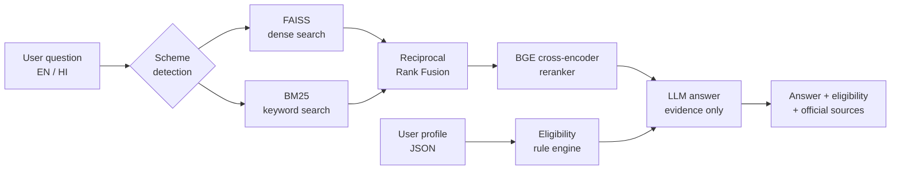

# BharatSahayak

**A bilingual (English and हिन्दी) assistant for Indian government welfare schemes.**

BharatSahayak answers questions about 11 central government schemes: benefits, who qualifies, documents, and how to apply. It also gives a preliminary eligibility check. Answers are grounded in a curated knowledge base and cite the official portal for each scheme.


---

## Features

- **Ask in English or Hindi.** Multilingual embeddings match Hindi questions to English source text, and the answer comes back in the language you choose.
- **Hybrid retrieval.** Dense search (FAISS + `multilingual-e5-small`) and keyword search (BM25) are merged with Reciprocal Rank Fusion, then reranked with the `BAAI/bge-reranker-v2-m3` cross-encoder.
- **Grounded answers.** The LLM may only use retrieved evidence. When a detail is missing, it says so and points to the official source instead of guessing.
- **Rule-based eligibility check.** A deterministic Python engine, not the LLM, checks a user profile against each scheme's listed conditions. Each condition comes back as *met*, *unmet* or *to verify*.
- **Works without an LLM.** With no API key set, the app still shows the retrieved source excerpts.
- **Scheme scoping.** Search all schemes, or limit a question to one. Scheme names and aliases in the question (for example "PM Kisan" or "पीएम किसान") are detected automatically.

## Supported schemes

| Scheme | Category | Eligibility rules |
|---|---|:---:|
| Pradhan Mantri Kisan Samman Nidhi (PM-KISAN) | Farmers | ✅ |
| Ayushman Bharat – PM Jan Arogya Yojana (PM-JAY) | Health | ✅ |
| Pradhan Mantri Awas Yojana – Urban (PMAY-U) | Housing | ✅ |
| Pradhan Mantri Awaas Yojana – Gramin (PMAY-G) | Housing | ✅ |
| Pradhan Mantri Jan-Dhan Yojana (PMJDY) | Banking | — |
| Atal Pension Yojana (APY) | Pension | — |
| Pradhan Mantri Jeevan Jyoti Bima Yojana (PMJJBY) | Insurance | — |
| Pradhan Mantri Suraksha Bima Yojana (PMSBY) | Insurance | — |
| Pradhan Mantri MUDRA Yojana (PMMY) | Loans | — |
| Pradhan Mantri Ujjwala Yojana (PMUY) | LPG | — |
| Pradhan Mantri Fasal Bima Yojana (PMFBY) | Crop insurance | — |

All 11 schemes support question answering. The eligibility check is available for the four schemes marked ✅.

## How it works



1. **Knowledge base.** [data/schemes.json](data/schemes.json) holds a curated record for each scheme (description, benefits, eligibility, documents, application process, official URL). [src/data_pipeline.py](src/data_pipeline.py) splits each record into section-wise chunks.
2. **Indexing.** Chunks are embedded with `intfloat/multilingual-e5-small` and stored in a FAISS inner-product index. A BM25 index is built over the same chunks plus scheme names and aliases.
3. **Retrieval.** Dense and keyword results are fused with RRF. The top candidates are reranked by the cross-encoder. If the reranker can't load, the app falls back to the RRF order.
4. **Generation.** [src/rag.py](src/rag.py) sends the top 5 chunks to any OpenAI-compatible chat endpoint (Gemini by default), using the rules in [src/prompts.py](src/prompts.py).
5. **Eligibility.** [src/eligibility.py](src/eligibility.py) evaluates the scheme's `eligibility_rules` against the profile. Missing fields are reported as *unknown*, never assumed.

## Getting started

### Prerequisites

- Python 3.13 (tested)
- About 3 GB of free disk space for the models
- *(Optional)* An API key for Gemini or any other OpenAI-compatible LLM

### Installation

```bash
git clone https://github.com/Aryan-Bharadwaj90/BharatSahayak.git
cd BharatSahayak

python -m venv .venv
# Windows
.venv\Scripts\activate
# macOS / Linux
source .venv/bin/activate

pip install -r requirements.txt
```

On first run, the embedding model (`intfloat/multilingual-e5-small`) and the reranker (`BAAI/bge-reranker-v2-m3`, about 2.3 GB) download from Hugging Face.

### Configure the LLM (optional)

Set these environment variables to use Gemini:

```bash
# Windows (cmd)
set LLM_API_KEY=<your Gemini API key>
set LLM_BASE_URL=https://generativelanguage.googleapis.com/v1beta/openai
set LLM_MODEL=<Gemini model name>

# macOS / Linux
export LLM_API_KEY=<your Gemini API key>
export LLM_BASE_URL=https://generativelanguage.googleapis.com/v1beta/openai
export LLM_MODEL=<Gemini model name>
```

Any OpenAI-compatible endpoint works. Change `LLM_BASE_URL` and `LLM_MODEL` to match your provider. To check the connection, run `python test_llm.py` or `python check_models.py`.

> Never commit your API key. Keep it in environment variables or a local `.env` file that is listed in `.gitignore`.

### Run

```bash
python app.py
```

Open <http://127.0.0.1:7860> in your browser.

## Usage

1. Type a question, or pick a quick-start card (PM-KISAN, Ayushman Bharat, PMAY-Urban).
2. Choose the answer language: **English** or **हिन्दी**.
3. *(Optional)* Under **Search within**, pick a scheme to limit the search to it.
4. *(Optional)* To get an eligibility check, open **Add an eligibility profile** and enter a JSON profile. A scheme must be selected for this.

**Example questions**

- What benefits does PM-KISAN offer?
- पीएम किसान योजना के क्या लाभ हैं?
- What documents do I need for PMAY-Urban?
- Which schemes can help a farmer with crop insurance?

**Example eligibility profile for PMAY-Urban**

```json
{
  "residence_area": "urban",
  "annual_household_income_inr": 600000,
  "family_has_pucca_house_anywhere_in_india": false,
  "allotted_house_under_any_government_housing_scheme_in_last_20_years": false
}
```

For this profile the check reports four conditions as met. The fifth (`previous_pmay_urban_house_curtailed_after_2023_12_31`) is listed as *to verify* because the profile doesn't include it. The field names for each scheme are in the `eligibility_rules` section of [data/schemes.json](data/schemes.json).

## Evaluation

The test set in [evaluation/test_questions.json](evaluation/test_questions.json) has **22 questions** (11 English, 11 Hindi). Each has a reference answer, reference evidence and the expected official source.

Retrieval results (top 5, from [evaluation/retrieval_results.csv](evaluation/retrieval_results.csv)):

| Metric | English | Hindi |
|---|:---:|:---:|
| Correct scheme in top 5 (Hit@5) | 1.00 | 1.00 |
| Official source in top 5 | 1.00 | 1.00 |
| Source precision@5 | 1.00 | 1.00 |
| Reference evidence coverage | 1.00 | 1.00 |

The test set is small and hand-curated, so treat these scores as a regression baseline, not a general benchmark.

Run the tests and evaluation:

```bash
python -m evaluation.test_eligibility               # eligibility engine tests
python -m unittest evaluation.test_regressions      # retrieval regression tests
python -m evaluation.evaluation --retrieval-only    # retrieval metrics, no LLM needed
python -m evaluation.evaluation                     # full run with RAGAS (needs LLM variables)
```

The full run scores answers with RAGAS (faithfulness, answer relevancy, context precision, context recall) and writes `evaluation/results.csv`.

## Project structure

```
BharatSahayak/
├── app.py                    # Gradio web interface
├── src/
│   ├── data_pipeline.py      # Loads scheme records, builds section-wise chunks
│   ├── embeddings.py         # Multilingual E5 embeddings
│   ├── retrieval.py          # FAISS, BM25, RRF fusion, cross-encoder reranking
│   ├── rag.py                # Evidence-grounded answer generation
│   ├── prompts.py            # System and user prompts
│   └── eligibility.py        # Deterministic eligibility rules
├── data/
│   ├── schemes.json          # Curated knowledge base (11 schemes)
│   └── processed/            # Prebuilt chunks and FAISS index
├── evaluation/               # Test questions, tests, evaluation script, results
├── assets/                   # CSS theme and illustration
├── enrich_schemes.py         # Knowledge-base maintenance
├── fix_scheme_aliases.py     # Knowledge-base maintenance
├── check_models.py           # Lists models available on the LLM endpoint
├── test_llm.py               # LLM connectivity check
└── requirements.txt
```

### Updating the knowledge base

After editing [data/schemes.json](data/schemes.json), delete the files in `data/processed/`. The app rebuilds the chunks and FAISS index on its next start.

## Tech stack

| Layer | Tools |
|---|---|
| UI | Gradio |
| Embeddings | `intfloat/multilingual-e5-small` (sentence-transformers) |
| Vector search | FAISS |
| Keyword search | rank-bm25 |
| Reranking | `BAAI/bge-reranker-v2-m3` |
| LLM | Gemini (any OpenAI-compatible API) |
| Evaluation | RAGAS, pandas |

## Disclaimer

BharatSahayak gives **preliminary guidance only**. It is not an official government service, and it does not check anyone's live beneficiary status. The relevant government authority makes all final eligibility decisions. Always confirm details on the official scheme portal before you apply.
